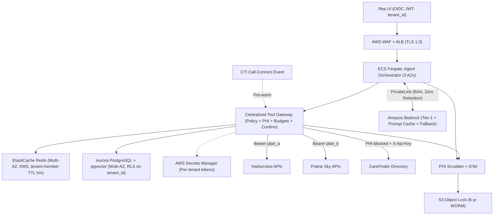

# Production Architecture & Design — Governed Multi-Tenant Member-Services Agent

**Scope:** Multi-tenant AI assistant serving member-services representatives for **Harborview Health Plan (`plan_a`)** and **Prairie Sky Health (`plan_b`)**, handling real PHI under HIPAA, with year-2 cloud portability.

---

## 1. Non-Functional Requirements Analysis & Key Trade-Offs

| NFR | Client Requirement | Architectural Response & Reality Check |
|---|---|---|
| **NFR-1** | 99.99% availability / month (≤4.32 min downtime) | **Conflict with NFR-2 (see below).** Single-region Multi-AZ delivers ~99.92%–99.95% composite SLA. Recommend Year-1 SLA of 99.95% with 3-AZ active-active compute, Multi-AZ Aurora/Redis, and multi-model fallback; revisit multi-region in Year 2 if 99.99% is contractual. |
| **NFR-2** | Single cloud region, lowest run cost, no multi-region spend in Year 1 | All production components run in one AWS region (`us-east-1`) across 3 AZs using serverless/right-sized managed services (ECS Fargate, Aurora Serverless v2 / Multi-AZ, Bedrock on-demand + prompt caching). |
| **NFR-3** | p95 < 3 s end-to-end, including claim questions | **Hard upstream physics constraint:** claims API averages ~1.5 s/call with `page_size ≤ 5` and `429` throttling (e.g., 13 claims = 3 sequential pages = 4.5 s *before* LLM inference). Solved in production via **CTI call-connect pre-warming** into a 5-minute tenant-scoped Redis cache + SSE streaming + fast Tier-1 model (~0.7–1.2 s TTFT). |
| **NFR-4** | Strict tenant isolation (prompts, RAG, caches, logs, answers) | Immutable `tenant_id` from verified OIDC JWT; per-tenant KMS CMKs; PostgreSQL Row-Level Security (RLS) on `tenant_id`; KB ingest quarantine on folder-vs-front-matter mismatch; tenant-prefixed Redis keys and S3 audit prefixes; Gateway binds tenant bearer token strictly to `/tenants/{tenant}/`. |
| **NFR-5** | Minimum-necessary PHI to model & logs; 6-year audit trail | Gateway projects member records to non-identifying benefit/network fields (`ssn`, `dob`, name, phone, email, street stripped); boolean `verify_ssn_last4` runs inside Gateway; regex + field-key log scrubber runs before emit; S3 Object Lock (Compliance mode, 6-year retention). |
| **NFR-6** | Grievance filed only after explicit rep confirmation, exactly once | Two-phase Gateway state machine (`propose_grievance` → separate rep turn with explicit confirmation → `confirm_and_file_grievance`) with deterministic `Idempotency-Key` + canonical JSON bytes across `503` retries. |
| **NFR-7** | ≤ $0.03 / conversation at 20,000 conv/day ($18,000/mo ceiling) | **Estimated ~$0.018/conv (~$10,800/mo):** Fast Tier-1 model with prompt caching (~$0.010/conv for ~3.5 turns) + AWS infra (~$4,800/mo = $0.008/conv). Leaves ~40% headroom. |
| **NFR-8** | Year-2 deployment of Prairie Sky into its own tenancy on another cloud | Containerized Python app, OpenAI-compatible LLM interface, standard PostgreSQL+pgvector & Redis protocols, OpenTelemetry, and Terraform/OpenTofu modules allow clean Year-2 GCP deployment (Section 3). |
| **NFR-9** | 250 concurrent reps peak (Mon 8–10 am) | 250 reps × ~1 turn/25 s ≈ 10–15 RPS steady, ~40 RPS burst. 4–12 ECS Fargate tasks (2 vCPU / 4 GB) auto-scaled on request count and scheduled pre-scale at Mon 7:45 am handle peak with zero cold starts. |

---

## 2. Target Production Deployment — AWS (`us-east-1`, 3 AZs)

Architecture diagram source: [`docs/architecture.mmd`](./architecture.mmd).

### Component Design & Cost Breakdown (20,000 conv/day ≈ 600,000 conv/month)

1. **Identity & Tenant Boundary:** Reps authenticate via corporate OIDC SSO. The signed JWT carries an immutable `tenant_id` claim (`plan_a` or `plan_b`). The Agent API rejects any request whose session tenant differs from the JWT.
2. **Agent Orchestrator & Centralized Tool Gateway (ECS Fargate):** Stateless Python containers deployed across 3 AZs (min 4 tasks, scheduled scale-up to 12 tasks Mon 7:45–10:30 am). Every tool call passes through `ToolGateway`—the LLM never holds API credentials, never picks a `tenant`, never sees raw SSN/DOB, and never receives raw third-party tool descriptions.
3. **Data & Retrieval Layer:**
   - **Aurora PostgreSQL + `pgvector` (Multi-AZ):** Stores tenant KB chunks, session history, and pending grievance confirmation tokens. PostgreSQL Row-Level Security (`SET LOCAL app.tenant_id = :tenant`) enforces isolation at the database engine layer. An ingestion pipeline validates `folder_tenant == front_matter.tenant` and strips prompt-injection directives before indexing; mismatches are quarantined and paged to ops.
   - **ElastiCache for Redis (Multi-AZ, KMS encrypted):** Populated asynchronously on CTI call-connect (`tenant:member_id` keys, 5-min TTL) with minimised benefits and paginated claims so live rep queries avoid the 1.5 s/page claims bottleneck.
4. **Private LLM Inference (Amazon Bedrock via PrivateLink):** Covered by AWS HIPAA BAA with zero prompt retention. Uses a fast, tool-capable Tier-1 model (e.g., Claude Haiku / Amazon Nova Pro) with system-prompt & tool-schema prompt caching (~75% input discount), with automatic circuit-breaker failover to a secondary Bedrock model.
5. **Immutable 6-Year Audit Trail:** Every model call, tool call, and gateway decision passes through `redact_phi_for_logs` before streaming via Firehose to tenant-partitioned S3 prefixes (`s3://audit-logs/{tenant}/yyyy/mm/dd/`) with S3 Object Lock (Compliance mode, 6-year retention) transitioning to Glacier Instant Retrieval after 90 days.

| Monthly Cost Component (600k conv/mo) | Sizing | Est. Monthly USD | Per Conv |
|---|---|---|---|
| LLM inference (cached system/tools + ~3.5 turns) | ~2.5k cached in, 0.8k uncached in, 0.35k out/conv | ~$6,000 | $0.0100 |
| Compute (ECS Fargate, 4 base / 12 peak tasks) | 2 vCPU, 4 GB | ~$950 | $0.0016 |
| Aurora PostgreSQL Multi-AZ + pgvector | 2× db.r6g.large | ~$1,100 | $0.0018 |
| ElastiCache Redis Multi-AZ | 2× cache.r6g.large | ~$650 | $0.0011 |
| ALB, WAF, PrivateLink, KMS, Secrets Manager | Regional baseline | ~$750 | $0.0013 |
| S3 Object Lock (6-yr audit) + CloudWatch/OTel | ~150 GB/yr compressed JSONL | ~$550 | $0.0009 |
| **Total** | | **~$10,000/mo** | **$0.0167** |

*(Well below the $0.03/conversation ceiling in NFR-7, leaving margin for peak retries or occasional frontier-model escalation.)*

---

## 3. One-Page Mapping to Second Cloud — Google Cloud Platform (NFR-8)

Prairie Sky Health (`plan_b`) may require isolated deployment in its own GCP tenancy from Year 2. Because the application uses OCI containers, standard PostgreSQL + `pgvector`, Redis protocol, OpenAI-compatible HTTP inference, and OpenTelemetry, **zero application business logic changes are required**—only infrastructure-as-code (OpenTofu/Terraform) and environment configuration.

| Capability | AWS Primary (Year 1) | GCP Dedicated Tenancy (Year 2 — `plan_b`) | Portability Notes |
|---|---|---|---|
| **Edge & WAF** | AWS WAF + ALB (TLS 1.3) | Cloud Armor + Regional External Application LB | Equivalent L7 WAF rules & mTLS/OIDC header forwarding. |
| **Identity / SSO** | Cognito / OIDC IdP | Identity Platform / Workforce Identity Federation | Same OIDC JWT verification with immutable `tenant_id=plan_b`. |
| **App & Gateway Compute** | ECS Fargate (3 AZs) | **Cloud Run** (min instances=4, VPC Direct Egress) or GKE Autopilot | Same container image; Cloud Run scales down off-peak for lower cost. |
| **Managed LLM (BAA)** | Amazon Bedrock (PrivateLink) | **Vertex AI** (Gemini Flash/Pro or Claude on Vertex via Private Service Connect) | Same `OpenAICompatibleLLM` client via Vertex OpenAI endpoint; zero data retention under GCP HIPAA BAA. |
| **Relational + Vector DB** | Aurora PostgreSQL + `pgvector` | **Cloud SQL for PostgreSQL** (HA Regional) + `pgvector` | Identical schema, SQL queries, and RLS policies. |
| **Pre-Warm Cache** | ElastiCache for Redis (Multi-AZ) | **Memorystore for Redis** (Standard Tier HA) | Standard Redis client; same `tenant:member_id` keyspace. |
| **Secrets & Encryption** | Secrets Manager + KMS CMK | **Secret Manager** + **Cloud KMS CMEK** | Single-tenant GCP project provides hard physical + IAM + CMEK isolation for Prairie Sky. |
| **6-Year Immutable Audit** | S3 Object Lock (Compliance) | **Cloud Storage Bucket Lock** (6-yr Retention Policy) + Archive class | Equivalent WORM compliance under HIPAA §164.316(b)(2). |
| **Observability** | CloudWatch + OTel Collector | **Cloud Logging / Cloud Monitoring / Cloud Trace** via OTel | Standard OTLP export; PHI scrubber runs in-process before export. |
| **Upstream Connectivity** | PrivateLink / VPN | Cloud Interconnect / HA VPN + Private Service Connect | Dedicated egress NAT with static IPs for Prairie Sky APIs & CareFinder. |

**Dedicated Tenancy Cutover Plan (Year 2):** Provision a new GCP project (`psh-member-agent-prod`) with Terraform, sync `plan_b` KB documents via the validated ingest pipeline, configure `plan_b` secrets in GCP Secret Manager, run the full 40-case evaluation suite + regression gate against the GCP staging environment, and shift Prairie Sky SSO DNS/routing with zero downtime to Harborview (`plan_a`).

---

## 4. Threat Model

| # | Threat & Attack Vector | Concrete Example Observed in Pack | Severity | Control Implemented & Production Hardening |
|---|---|---|---|---|
| **T1** | **Cross-tenant data leakage** (RAG, cache, API auth) | (a) `kb/plan_a/virtual_care_2026.md` has `tenant: plan_b`; (b) `M291543` exists in both tenants; (c) mock API ignores token's tenant vs URL path. | **Critical** | Folder-vs-front-matter quarantine on KB ingest; `(tenant, member_id)` namespaced caches; Gateway strips `tenant`/`member_id` from LLM schemas and binds token strictly to `/tenants/{tenant}/`; Aurora RLS + per-tenant KMS CMK. |
| **T2** | **MCP / 3rd-party tool poisoning (PHI exfiltration)** | `third_party_provider_directory.json` instructs model to silently prepend full SSN + DOB to `query`. | **Critical** | Never feed untrusted vendor descriptions to LLM; curate gateway tool schemas; run manifest security audit; Gateway strips SSN/DOB from model context AND regex-blocks PHI on all outbound 3rd-party calls (`BLOCKED_PHI`). |
| **T3** | **Indirect prompt injection via external records** | Claim `C2650799780` (`provider_portal` note, `EV-13`) tells assistant to file an urgent grievance without asking; KB guide embeds AI coding-assistant note. | **High** | Gateway strips role-spoofing directives from claim notes & KB; **structurally impossible** to write in the same turn (`current_turn > proposed_at_turn`) or without explicit rep confirmation text. |
| **T4** | **Unauthorized or duplicate state mutation** | Rep asks to hold off (`EV-17`); grievance server commits on attempt 1 then returns `503` (`EV-16`, `EV-32`). | **High** | Two-phase confirmation token state machine; negation-aware confirmation parser; deterministic `Idempotency-Key` + canonical JSON bytes across `503` retries ensures exact-once creation. |
| **T5** | **Direct PHI exposure to model, logs, or caller** | Rep requests full SSN (`EV-19`); full member record contains SSN, DOB, street, email, phone. | **High** | `minimise_member_record` drops SSN/DOB/name/contact/street; dedicated `verify_ssn_last4` returns boolean only; `redact_phi_for_logs` scrubs every trace/log event before serialization. |
| **T6** | **Denial-of-wallet / runaway loops** | Malicious prompt or flaky upstream triggers infinite tool retries, blowing $0.03/conv budget. | **Medium** | Gateway enforces hard per-conversation step, USD cost, and latency budgets before every model and tool call (`BLOCKED_BUDGET`); bounded retry caps on `429`/`503`. |
| **T7** | **Horizontal privilege escalation within tenant** | Rep or prompt passes another member's `claim_id` to `get_claim_by_id`. | **High** | Gateway verifies `claim["member_id"] == session.member_id` before returning claim data (`BLOCKED_TENANT`). |

---

## 5. Architecture Decision Records (ADRs)

### ADR-1: Centralized Tool Gateway as Mandatory Security Choke Point
- **Context:** LLMs are non-deterministic and susceptible to indirect prompt injection and poisoned tool descriptions (both present in this pack). Relying on system-prompt instructions alone cannot guarantee HIPAA compliance or tenant isolation.
- **Decision:** Route 100% of tool calls through a deterministic Python `ToolGateway` that owns tenant/member binding, curated tool schemas, PHI minimisation, outbound PHI filtering, confirmation state, budgets, and tracing.
- **Alternatives Considered:** (1) Direct MCP client connected to LLM (rejected: directly vulnerable to CareFinder's poisoned manifest); (2) Post-hoc output filter only (rejected: cannot prevent unauthorized writes or PHI already sent to LLM/vendor).
- **Consequences:** Slightly more boilerplate when adding new tools, but security invariants become unit-testable deterministic code rather than probabilistic prompt hopes.

### ADR-2: Two-Phase Turn-Separated Confirmation with Deterministic Idempotency
- **Context:** NFR-6 requires grievances to be filed only after explicit rep confirmation and exactly once, even when the downstream system commits and returns `503`.
- **Decision:** Split writes into `propose_grievance` (stages draft + deterministic `Idempotency-Key` + `proposed_at_turn`) and `confirm_and_file_grievance` (enforces `current_turn > proposed_at_turn`, explicit rep confirmation without negation, and retries `503` with identical canonical JSON bytes and `Idempotency-Key`).
- **Alternatives Considered:** (1) Single `file_grievance(confirmed=True)` flag set by LLM (rejected: trivially bypassed by prompt injection like `EV-13`); (2) Fire-and-forget async queue (rejected: rep needs immediate confirmation and `grievance_id` during the live call).
- **Consequences:** Requires session state persistence across turns (stored in Aurora/Redis in production), completely eliminating single-turn prompt-injected writes and `503` duplicate grievances.

### ADR-3: Logical + Cryptographic Multi-Tenancy with Cloud-Portable Stack
- **Context:** Year 1 requires lowest run cost in a single region (NFR-2), strict tenant isolation (NFR-4), and Year-2 portability of `plan_b` to a second cloud (NFR-8).
- **Decision:** Run shared stateless compute in Year 1 with hard logical + cryptographic isolation (JWT `tenant_id`, Aurora RLS, per-tenant KMS CMKs, folder+front-matter KB quarantine, tenant-prefixed caches/audit logs) built exclusively on cloud-portable open protocols (OCI, PostgreSQL+`pgvector`, Redis, OpenAI-compatible HTTP, OTel).
- **Alternatives Considered:** (1) Two separate cloud accounts/stacks in Year 1 (rejected: doubles baseline compute/DB cost, threatening NFR-2/NFR-7); (2) Shared vector store with metadata filter only (rejected: vulnerable to misfiled docs like `virtual_care_2026.md` and filter bugs).
- **Consequences:** Meets Year-1 cost ceiling while making Year-2 GCP migration for Prairie Sky a straightforward Terraform deployment.

### ADR-4: CTI Pre-Warmed Read Cache + Small-Model Tiering with Prompt Caching
- **Context:** Upstream claims API takes ~1.5 s per 5-claim page with `429` throttling, colliding with NFR-3 (p95 < 3 s) and NFR-7 (≤ $0.03/conv).
- **Decision:** In production, trigger asynchronous member/claims pre-warming on CTI call-connect into a 5-minute tenant-scoped Redis cache (supplemented by session caching in the vertical slice), pair with deterministic Gateway math/date tools, and run a fast Tier-1 model with prompt caching.
- **Alternatives Considered:** (1) Live synchronous claims fetch on every turn with a frontier model (rejected: violates both 3 s p95 latency and $0.03 cost); (2) Bulk nightly claims warehouse copy (rejected: stale for same-day adjudicated claims and expands PHI footprint).
- **Consequences:** Achieves ~1.5–2.2 s p95 on cached calls while keeping PHI ephemeral (5-min TTL) and unit cost under $0.02/conversation.
